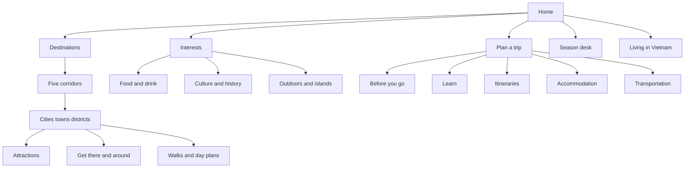
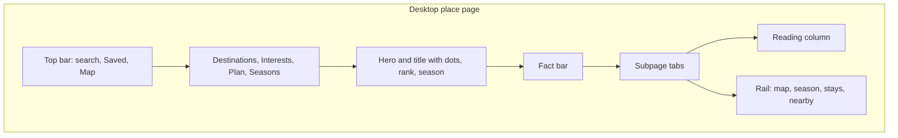

# Vietnam Guide: product, design, and content plan

English-first reference site, the same job japan-guide does for Japan. Vietnamese names sit in the title (`Hội An`), ASCII slugs in the URL (`/hoi-an`). A `/vi/` edition can be added later on the same topic tree. Do not reuse japan-guide’s numbered URLs or its prose.

The workspace is empty. This plan is the product spec. Building starts after it is approved.

## What to copy, and what to replace

Copy the product, not the country:

- Objective evergreen pages, so a pagoda in Hue and a cave in Quang Tri use the same skeleton.
- A web of internal links: corridor, nearby places, how to get there, food, itinerary.
- A live season desk people recheck in peak weeks.
- Practical modules in a fixed order: what it is, how good it is, how to get there, hours, fees.
- Commercial modules that are obviously separate from the guide: stay search, transport search, a labeled sponsored story.

Replace the Japan-specific pillars:

- **Trains and a rail pass** become flights, sleeper and limousine buses, the Reunification Express, Grab, ferries, and motorbike loops. There is no national rail pass.
- **Prefectures** become two layers. Traveler destinations are the pages people search. The 34 provinces (Resolution 202/2025; a few units became centrally run cities in 2026) are map and admin metadata.
- **Shrines, castles, onsen, anime districts** become pagodas and communal houses, imperial citadels and ancient towns, caves, beaches and islands, coffee, markets, and motorbike loops. Hot springs and mud baths get one interest page.
- **Sakura and koyo** become rice-terrace status, Ha Giang buckwheat flowers, Tet flowers, lotus, coffee blossom and harvest, and central-coast flood and typhoon status.

Search name wins over the new admin name. The new province appears in the breadcrumb note and in one sentence (“Part of Da Nang since 2025”).

- Ha Giang Loop stays `/ha-giang` (province: Tuyen Quang).
- Hoi An and My Son stay `/hoi-an` and `/my-son` (city: Da Nang).
- Phong Nha stays `/phong-nha` (province: Quang Tri).
- Mui Ne stays `/mui-ne` (province: Lam Dong).
- Sapa stays `/sapa`; Mu Cang Chai stays its own page (both in Lao Cai).
- Phu Quoc, Con Dao, Cat Ba, and Cham Islands stay island pages even when the parent province changed.

Confirm each parent against the official list before publishing province pages. Famous-place URLs do not wait on that.

## Sitemap

### Destinations

Five corridors, north to south. These match how trips are built. Post-merger official regions mix coast and highlands inside single provinces, so they are a map layer, not the main nav.

- **Northern Vietnam** — Hanoi, Ha Long and Cat Ba, Ninh Binh, Sapa, Ha Giang, Cao Bang, Mai Chau and Pu Luong, plus the quieter northern provinces.
- **Central Coast** — Phong Nha, Hue, Da Nang, Hoi An, My Son.
- **Highlands and South-Central Coast** — Da Lat, Buon Ma Thuot, Quy Nhon, Nha Trang, Mui Ne. Inside the corridor page, highlands and beaches are two clusters.
- **Ho Chi Minh City and the Southeast** — the city, Cu Chi, Tay Ninh, Vung Tau, Can Gio.
- **Mekong Delta** — Can Tho, floating markets, Ben Tre, Chau Doc, Ca Mau.

Islands stay under their corridor and also appear on the Beaches and islands interest. Phu Quoc, Con Dao, Cat Ba, Cham Islands, Ly Son.

Every corridor page: one objective paragraph, climate in one sentence, map, top places with dots and rank, current season reports, and how many days to allow.

Three levels under that:

- **Province** (`/provinces/da-nang`) — what the merger changed for a traveler, main towns, how people move through it. Completeness and map parent. Most visitors land on the town instead.
- **City, town, or district** (`/hanoi`, `/hoi-an`, `/hanoi/old-quarter`) — the workhorse.
- **Attraction** (`/hoi-an/japanese-covered-bridge`) — the reference card.

### Place subpages

Tabs are real URLs so each practical question can rank on its own. Shared chrome, unique title and H1.

- `/hoi-an` — Intro
- `/hoi-an/attractions` — grouped by district
- `/hoi-an/interests` — food, pagodas, markets, rain, children
- `/hoi-an/get-there` — flight, train, bus, Grab, ferry, motorbike, walking
- `/hoi-an/itineraries` — half day, full day, side trips
- `/hoi-an/stay` — which area to sleep in, types, price bands
- `/hoi-an/eat` — dishes, districts, what a meal costs, verified date

Point-to-point routes live at `/get-there/hanoi-to-sapa`, linked from both towns.

### Attraction card

Same fields every time: what it is, editorial dots, traffic rank once it qualifies, time needed, get there, hours, closing day, fee in VND with a verified date, map pin, interest tags, combine with, nearby.

### Interests

- **Food and drink** — hub, dish pages, city food guides, how to order, market manners, regional cooking.
- **Pagodas and temples** — Buddhist pagodas, village đình, Cao Dai, Cham towers, churches, plus one shared etiquette page.
- **Citadels and ancient towns** — Hue, Thang Long, Hoi An, Co Loa.
- **Caves and karst** — Phong Nha, Trang An, Ha Long, Tam Coc.
- **Beaches and islands**
- **Rice terraces and rural scenery**
- **War history and the DMZ** — site by site, factual.
- **Peoples and highland life** — Sapa, Bac Ha, Mai Chau, Central Highlands. Market days, how to visit, ask-before-photos.
- **Coffee** — egg coffee, cà phê sữa đá, highlands harvest.
- **Markets** — night markets, floating markets, Tet flower markets.
- **Shopping** — tailors, lacquer, ceramics, silk, coffee, what is worth buying.
- **Festivals** — Tet, Hoi An full moon, Hue Festival, Mid-Autumn, Hung Kings, Khmer and Cham festivals.
- **Outdoors** — hiking, diving, motorbike loops, national parks.
- **Hot springs and mud baths** — one hub.

### Plan a trip

- **Before you go** — when to travel by the three climate zones, e-visa, money, SIM and Wi-Fi, luggage forwarding, electricity, pharmacies, emergencies, typhoons, floods, heat.
- **Learn** — street traffic, shoes and houses, eating, pagodas, toilets, bargaining, homestays.
- **Itineraries** — national, corridor, timed walks.
- **Accommodation** — hotel, resort, homestay, stilt house, hostel, serviced apartment, overnight bay boat, with price bands.
- **Transportation** — flights, train, sleeper buses, Grab and taxis, ferries, driving, motorbike rental, Hanoi and Ho Chi Minh City metros. City getting-around pages for Hanoi, Da Nang, Hoi An, Hue, and Ho Chi Minh City.

Special-traveler pages sit under Before you go: solo, children, halal food, accessible travel.

### Itinerary shapes

- **National** — 14 days Hanoi to Ho Chi Minh City, 10 days without the delta, 7 days in the north, 5 days on the central coast, 5 days in the south. Each day links to a place page.
- **Timed walks** — duration, cost band, pace, then stop, minutes there, minutes walking. First walks: Hanoi Old Quarter, Hue citadel, Hoi An old town, Da Nang to Hoi An, Ho Chi Minh City District 1 and 3.
- **Side trips** — Ninh Binh from Hanoi, Ha Long from Hanoi, Phong Nha from Hue, Mekong from Ho Chi Minh City, Cat Ba from Ha Long.

### Season desk

A national map with a status on each site: too early, approaching, peak, past, or closed by weather.

- **Rice** — water, green, and gold for Mu Cang Chai, Sapa, Hoang Su Phi, Pu Luong, Mai Chau, Tam Coc. Northern gold is usually September–October. Tam Coc is often late May.
- **Flowers** — Ha Giang buckwheat (often October–November), plum blossom in Moc Chau and Sapa, lotus, Tet peach and apricot markets.
- **Weather ops** — central-coast flood and typhoon notes from September to November, Hoi An flood level, sea notes for Ha Long, Nha Trang, and Phu Quoc.

A report is a dated field note: place, date, status, three photos, one short paragraph. It links to the evergreen page. It does not rewrite it. The evergreen page keeps the typical calendar and shows the latest status chip when a report exists.

### Living in Vietnam

Phase 3. Visas beyond tourism, work, apartments, cost of living, banking, motorbike registration, utilities, shipping. Kept off the tourist tabs so those stay scannable. Changing facts carry a verified date and an official source.

## Visual design

A field manual with large photographs. The photo introduces the place. The fact bar answers the trip question. Color is quiet so season status and rank stay readable.

### Tone

Paper, ink, and one lacquer accent. Photography does the spectacle. The interface stays still: sharp corners, thin rules, no card shadows, no tropical gradients, no script body text. Vietnamese diacritics are a font requirement, not an afterthought.

### Color

- Paper `#F6F3EC`, card `#FFFcf7`, ink `#1C1915`, secondary `#5C564C`, rule `#E4DDD0`.
- Lacquer `#8C2F2F` for links, the current tab, and the primary button. Used in small doses.
- Season: peak `#8F6A1F` on a sand chip, approaching `#1F4E6B`, too early and past `#6E685F`, weather closure `#8C2F2F`.
- Map land `#E4EDE4`, water `#D3E2EA`, route line lacquer.
- Rank chip is ink on paper. It must not look like a paid badge.

### Type

- Place titles: Source Serif. Supports Vietnamese.
- UI, body, facts, tables: Source Sans. 17px body, 1.5 line height, 680px measure.
- Rank, fees, and times: tabular figures.
- Scale: 12 labels, 14 meta, 17 body, 22 section, 36–48 place title.

### Layout grid

- Page max 1120px. Reading column 680px. Rail 320px. Gap 32px.
- Desktop place page is two columns. Mobile is one column, map in a sheet.
- Cards: 3 / 2 / 1 across desktop, tablet, phone.
- Photos: 3:2 on cards, 16:9 hero capped at 420px desktop and 220px mobile so the fact bar is on screen without a scroll on a laptop.

### Photography

- Hero is a real place photo, credited, with a short caption (month and neighborhood).
- A scrim sits only behind the title, not across the whole photo.
- Cards crop to the subject. Alt text names the place and what is visible.
- Season reports use their own photos. Evergreen heroes can stay until a better frame exists.

### Components, same on every page of a type

- **Fact bar** — four cells: time needed, fee or price band, get there in one line, best months. This is the first thing under the title.
- **Dot row** — five dots, editorial, with a one-line reason (“Worth a full day”).
- **Rank chip** — `#3 in Northern Vietnam` once the place qualifies. Hidden until then.
- **Season chip** — status, report date, link.
- **Interest tags** — small text tags, each a filter link.
- **Place card** — photo, name, Vietnamese name, one line, dots, rank, tags.
- **Timeline stop** — time block, walk minutes, map link.
- **Disclosure line** — “Partner link” or “Ad” in 12px secondary text on every commercial unit.

## UI and UX

The site trains people the way a reference manual does: the same slots, in the same order, on every town.

### Chrome

- Top bar, 56px: wordmark, search field, Saved, Map. On mobile: wordmark, search icon, map icon.
- Nav: Destinations, Interests, Plan a trip, Seasons. Living sits in the footer and in Plan’s overflow until Phase 3.
- Destinations mega-menu: five corridors, each with its four highest Recommended places. The menu is a ranking surface, so the order updates when ranks update.
- Breadcrumb: corridor / place / subpage. Province is a text note under the title.
- Footer: corridors, plan topics, about, corrections, affiliate disclosure, privacy.

### Place page behavior

- Desktop rail order is fixed: mini map, season status, stay-search partner block, nearby places by rank, then one ad if a campaign is active.
- Mobile order: hero, title, dots and rank, fact bar, tabs, body. Map opens as a bottom sheet at 60% height, dragged to full screen. Partner block sits after the first practical section of that subpage (Get there, Stay, or Eat), once. One ad sits after the third section.
- On scroll, a condensed bar replaces the hero: place name, dots, season chip, tabs. The fact bar collapses to a single line.
- Tabs show the current subpage in lacquer. Changing tab keeps scroll at the tab bar, not at the hero.
- “Add to trip” saves the place locally in Phase 1. No account wall.

### Lists and sort

Every list of places or attractions has the same control:

- **Recommended** — default. Quality first, then the active interest, then traffic.
- **Most visited** — traffic rank inside the current parent (country, corridor, town, or interest).
- **By interest** — requires a tag. Highest interest weight first.
- **A to Z** — for people who already know the name.

District grouping stays available on town attraction lists, as a second control next to sort. Japan-guide’s “recommended / by district” pattern, plus the traffic sort.

### Search

A single field in the top bar, opening a panel.

- Groups: Places, Attractions, Routes, Food, Practical.
- Exact title match first, then Recommended score inside the group.
- Routes match phrases like “Hanoi to Sapa” and “Ha Long from Hanoi”.
- Recent searches stored locally.
- Zero results offer the corridor list and the season map, not a dead end.

### Map

One map, three zooms, same place IDs as the pages.

- Country: corridors and season dots.
- Corridor: towns sized slightly by rank, route lines for the classic itinerary.
- Place: attractions, markets, stations, and the active walk as a line. Selecting a pin scrolls the list. Selecting a card moves the pin.
- Layers: sights, food, transport, seasons. The interest filter and the layer stay in sync.
- Keyboard: pins are buttons with names. The sheet traps focus while open.
- First paint is a static map image or an inline SVG. The interactive library and tiles download only after the reader opens the map, or after the desktop rail is on screen.

### Walks

A vertical timetable on the left, map on the right (desktop) or a step list with a “show on map” control (mobile). The active stop is lacquer. Each stop links to its attraction card. Duration, cost band, and pace sit above the first stop.

### Season desk UX

Map on the left, report list on the right, peak status first. A month switcher changes the typical calendar under the live chips. Live chips always win when a report is newer than 14 days. Older reports stay readable and are labeled with their date so a November photo is not mistaken for today.

### Trust and empty states

- Fees, hours, and visa rules show “Verified 12 Oct 2026” in the fact bar. If the date is past the review window, the public page still shows the date. The admin queue flags it.
- Missing fee: the cell reads “Check on arrival” and the page still publishes. A blank commercial-looking hole does not.
- Skeleton states match the fact bar and cards so layout does not jump.
- Commercial slots are omitted from the DOM when no partner is configured. Reserved height exists only for a live ad, to protect Core Web Vitals.

### Accessibility

- Contrast of ink on paper passes WCAG AA. Lacquer links are underlined, not color-only.
- Hit targets 44px. Tabs are links.
- The fact bar, timetable, and season list are readable with the map and scripts turned off.

## Fast loading

The guide is built for Vietnamese 4G, hotel Wi-Fi, and roaming SIMs. The title, fact bar, and opening paragraph arrive in the first HTML response and can be read before any script runs.

### Architecture

- Every public URL is static HTML generated at build time. The article, fact bar, lists, rank chip, and season chip are in that document.
- Rank scores are computed on a schedule and baked into the HTML. The browser does not wait on an API before paint.
- Search, the interactive map, and the save button are islands. The rest of the page does not hydrate.
- The public site is a static-output generator (Astro fits this) so a reading page ships almost no JavaScript. The git-backed editor from the update workflow sits on the same files.
- Files are served from a CDN with Brotli, HTTP/3, hashed assets cached for a year, and HTML cached at the edge with stale-while-revalidate.

### What loads when

Before first paint, a reading page may load only:

- The HTML document
- One CSS file, with the top bar, title, and fact bar rules inlined in the document
- A single hero image on pages that have one

After the page is readable, or when the reader asks:

- Map library and tiles, on Map click, or when the desktop rail enters the viewport
- The search index, when the search field is focused
- The analytics beacon
- An ad script, in Phase 2, after the load event and an idle callback
- Partner blocks as HTML links and a small form. A stay search is a link-out with the town name filled in. No booking widget, no iframe, and no partner script in the document head

Third-party requests on first load: none. No tag manager, chat widget, social embed, or icon font.

### Budgets

CI runs these on the home page, a place intro, a practical guide, and a route page, using a Slow 4G profile and a mid-range phone. A preview that misses a budget does not publish.

- LCP under 2.0 seconds
- INP under 200 milliseconds
- CLS under 0.05
- Lighthouse performance 95 or higher
- Compressed HTML for a place intro under 80 KB
- CSS under 20 KB gzipped
- JavaScript downloaded before any interaction under 15 KB gzipped
- Mobile hero under 80 KB
- Above-the-fold image count: one

### Images

- The build emits AVIF and WebP at fixed widths. Hero: 480, 800, and 1600. Card: 320 and 640.
- Every image has width and height attributes.
- The hero is preloaded and marked high priority. Cards use native lazy loading.
- The space behind a loading hero is the paper color, so the fact bar does not jump and a blur placeholder never becomes the largest element.
- Each page has one hero. Off-screen card images stay unloaded.

### Map and season desk

- A place page first paints a static map image or a small inline SVG, with the pin name in HTML beside it.
- MapLibre, or a similarly light library, plus tiles, download only after the reader opens the map or the rail is visible.
- The country season map is an inline SVG with HTML status dots. It works with scripts disabled. The heavier map is an upgrade on that page only.

### Fonts, search, and the next click

- Fonts are self-hosted, subset to Latin and Vietnamese, in woff2, with metric-matched fallbacks so text does not shift when the font arrives.
- Search uses a static index, fetched on focus. The index is not on the critical path.
- When the tab bar is on screen, the browser prefetches the sibling subpages (Eat, Get there, Stay) so the next click is a cached document.
- Saved trips and recent searches live in local storage and add no server round trip.

### Ads, analytics, and repeat visits

- Display ads, once a campaign exists, load inside a fixed-size slot after idle. The slot is in the DOM only while a campaign is on, which keeps CLS at the budget.
- Analytics is a deferred beacon. It records the rank events and affiliate clicks after load. It does not sit in front of the HTML.
- A service worker is a Phase 2 extra. It caches the last corridor pages and the season SVG for repeat visits. The first visit is fast without it.

### Publishing rule

Preview fails when the fact bar sits under an oversized hero, when a third-party script is present on first load, or when any budget above is missed. Speed is a publish check, the same as a missing required section.

## Ranking

Three public signals, kept separate so traffic cannot crown a weak place and a sponsor cannot buy a rank.

### 1. Editorial dots

Set by the owner or an editor. Five dots. Meaning is fixed and published on `/about/ratings`:

- 5 — worth building a day around
- 4 — worth a special trip inside the corridor
- 3 — worth it if you are already there
- 2 — short stop or niche interest
- 1 — listed for completeness

Dots change when the place changes, not when traffic changes. A closed or degraded place can be lowered the same day.

### 2. Interest weights

Each place and attraction carries weights from 0 to 5 on the shared tags: food, old towns, pagodas, caves, beaches, islands, mountains, rice scenery, markets, war history, coffee, nightlife, family, photography, motorbike.

Editors set them. They power “By interest” and the interest subpage. A beach town can rank first for beaches and mid-pack for food. Weights are visible as tags. The numeric weight is an admin field, shown publicly only as the sort order.

### 3. Traffic rank

Observed attention over a rolling 90 days, inside a parent set (all Vietnam, one corridor, one town’s attractions, one interest).

Events that count:

- Unique session on the place or attraction page, weight 1
- Engaged session (30 seconds or half the intro scrolled), weight 2
- Map pin opened for that place, weight 1.5
- Save to trip, weight 3
- Click onward to that place’s Get there subpage, weight 2

A 14-day spike (season report traffic) is shown as a separate **Trending** chip. It is stored at half weight inside the 90-day score so one viral week does not freeze the rank until the window expires.

Public label, japan-guide style, once qualified: `#4 most visited in Central Coast` and `#6 of 32 attractions in Hoi An`. Qualification: at least 28 days since publish and 500 sessions. Before that, dots and tags show, and the rank chip stays off. New pages can still surface through search and through Recommended inside their corridor because editorial dots carry them.

### Recommended sort

Default order everywhere lists appear:

- Start with editorial dots, scaled 0–50.
- Add interest match, 0–20, only when a tag filter is on. With no filter, this term is zero so the default list is not secretly a food list.
- Add a capped traffic term, 0–15, from the log of the 90-day score. Traffic breaks ties. It does not outrank a 5-dot place with a 3-dot place.
- Drop places marked Closed or Unsafe from Recommended. They remain on A to Z with a status chip.

The formula is public on `/about/ratings`. Sponsored stories and partner buttons are excluded from every term. Clicks on affiliate blocks are not rank events.

### Where rank appears

- Place hero and attraction card
- Corridor and interest lists
- Destinations mega-menu (top four Recommended per corridor)
- Search results, after exact matches
- Map, as a small numeral on the pin at corridor zoom
- Owner dashboard: rank now, rank 28 days ago, top interest tag, top inbound page

Rank does not appear inside sentence prose. The paragraph stays objective. The chip carries the number.

## Ads and affiliates

Commercial units pay for the site. They sit in known slots, they are labeled, and they never occupy the fact bar, the first screen title, or the rank formula.

### Labels

- Affiliate module: “Partner link. We may earn a commission if you book.” The module is HTML. Partner widgets and iframes stay off the page so they cannot delay the fact bar.
- Display unit: “Ad”.
- Sponsored story: “Sponsored” on the card and “Advertiser content” at the top of the article. A sponsored story cannot receive dots, a most-visited rank, or a Recommended slot. It has its own row, “From partners”.
- Footer sitewide: one disclosure sentence and a link to `/about/partners`.

### Slot map

Place intro, desktop rail, under the map and season chip:

- Stay search for this town. Fields prefilled with the place name. Partners in order of fit for Vietnam: Agoda, Booking.com, Traveloka. One module, one partner active per place, set in admin.

Place Get there, after the comparison table:

- Transport module matched to the mode in that section. Buses: Vexere or 12Go. Flights: an airline or metasearch deep link with the route prefilled. Trains: official Vietnam Railways link plus a bookable partner if one exists. The official link stays even when the partner is present.

Place Stay, under the area guide:

- The same stay search, plus a text list of accommodation types with price bands written by the editor. The partner module does not replace the area advice.

Place Eat and attraction pages:

- Optional experiences module (Klook, GetYourGuide, or Viator) only when the page is a bookable activity: a cooking class, a bay cruise, a guided cave. Restaurants do not get a fake “book a table” button unless a real partner exists.

Before you go, SIM and insurance pages:

- One partner each (eSIM, travel insurance), under the editorial steps.

Home and season desk:

- One “From partners” story slot below the season map. Display ads are off these two pages in Phase 1 so the season tool stays fast and trusted.

Display ads, Phase 2 once there is traffic worth selling:

- One in-content unit after the third section on desktop and mobile.
- None on visa, emergency, typhoon, flood, or accessibility pages.
- None above the fact bar. None inside the map. A maximum of one display unit per page.
- If the ad network is empty, the slot is not rendered.

### What the owner controls

Per slot: on or off, partner, destination prefill, campaign dates. Turning a partner off collapses the slot. Rank, dots, and interest weights are not fields on the partner form.

Affiliate clicks are measured for revenue. They are stored apart from the rank events.

## How the owner updates

One content schema. Two doors: an admin the owner can use directly, and repo files an agent can edit. Both write the same fields. A preview URL is required before anything public changes.

### Schema, shared by both doors

Each place, attraction, route, dish, practical page, and season report is a typed record:

- Identity: id, slug, Vietnamese name, English name, corridor, province, coordinates, parent id
- Editorial: summary (50–70 words), body sections in a fixed order, dots, one-line dot reason, interest weights, status (draft, published, closed)
- Facts: time needed, fee, currency, hours, closing days, get-there summary, best months, source URL, verified date
- Media: hero, card, caption, credit, alt
- Relations: nearby ids, combine-with ids, route ids, itinerary ids
- Commercial: which partner slots are on, prefill values
- SEO: title, meta description, canonical, index boolean, FAQ pairs

Season reports are a smaller record: place id, observed date, status, 3 photos, 80–120 word note, author.

The body is structured sections, not a free blog canvas. An agent, and the owner, fill named sections. The template decides where they render. That is what keeps a Hue pagoda and a Phong Nha cave identical on the page.

### Door 1 — owner, direct

A private admin at `/admin`, password or magic link, four daily jobs:

- **Edit a page** — form matches the schema. Place, attraction, route, dish, and practical pages each have a form. Rich text is limited to paragraphs, lists, and links inside a section. The owner cannot drag a new layout.
- **File a season report** — shortest form. Place, status, note, photos, publish. This is the daily tool during rice, flower, and storm weeks.
- **Mark verified** — a button on fee, hours, and visa fields that stamps today’s date and keeps the source URL. The stale queue lists anything unverified longer than its window: visa 30 days, fees and hours 90 days, transport prices 45 days, evergreen prose 180 days.
- **See rank** — read-only table: place, dots, top interest, 90-day rank, change since last month, sessions. The owner does not type the rank.

Publish flow: save draft, open preview on the real template with a noindex header, then publish. Unpublish sets status to draft and returns 404. Closed keeps the URL, shows the status chip, and drops Recommended.

Photos upload in the admin, are compressed on upload, and require alt text before publish.

### Door 2 — agent

Content records live in the repo as one JSON or MDX file per page, validated by the same schema. The owner can ask an agent, in Cursor or a later admin agent, to:

- Draft a new place from the template (“Add Tam Coc with these notes”).
- Patch a fact (“Set the Hoi An bridge fee and stamp verified, source is this URL”).
- File a season report from photos and a field note.
- Refresh a stale page the queue names.
- Add internal links the schema requires: corridor, two nearby places, one route, one food link, one itinerary.

Agent rules, stored in the repo so every session follows them:

- Fill the schema. Do not invent a layout, a fee, an hour, or a visa rule.
- If the source is missing, leave the fact blank and say so in the draft summary.
- Show a diff. The owner publishes, except season reports when the owner has turned on “agent may publish reports”.
- Never edit rank math, partner payment settings, or the formula page except when the owner asks for a formula change.
- Keep search-name slugs. Do not move Hoi An under a new province slug.
- Run the schema check before handing the draft back. A missing required section blocks preview.

The admin and the repo stay aligned by treating git as the source of record in Phase 1. The admin is a visual editor on those files (a git-backed editor such as Keystatic on the static site: the owner gets forms, the agent gets files). A hosted CMS is a later option if a non-technical editor needs access without the repo. It must map onto this schema, and public pages must still be static HTML.

### Roles

- **Owner** — publish, partners, dots, interest weights, formula page.
- **Editor** — drafts and season reports. Publish if the owner allows.
- **Correspondent** — season-report form only, for people in the field.
- **Agent** — drafts everything, publishes only season reports when that switch is on.

### Corrections

A footer link, “Suggest a correction”, sends page URL, field, and note to an admin inbox. It creates a draft task. It does not change the live page. The public page shows “Updated” from the last publish, which covers both owner and agent edits.

## SEO and GEO

GEO means being the page Google AI Overviews, ChatGPT, and Perplexity can cite with confidence. The same choices help classic search.

### Titles and intros

Patterns, generated from fields so they stay consistent:

- Place: `Hoi An travel guide — what to do, how to get there, where to eat`
- Attraction: `Japanese Covered Bridge — hours, tickets, and how to get there`
- Route: `Hanoi to Sapa — train, bus, flight, and motorbike`
- Dish: `Bun cha — what it is, how to eat it, where it is from`
- Season: `Northern rice terraces — live status, October 2026`

H1 is the place name plus the Vietnamese name. The first 50–70 words define the place in plain sentences, then the fact bar repeats the extractable facts. That pair is what answer engines lift.

Meta descriptions are written, 140–160 characters, and include the practical hook (how long, how to arrive). They are a field, not an afterthought pasted from the first paragraph.

### Indexing

- Index: place subpages, attractions, routes, dishes, itineraries, practical guides, corridor pages, province pages that contain original merger guidance, season reports.
- Noindex: search result URLs, sort variants (`?sort=visited`), interest filter combinations, admin, previews, partner redirect URLs.
- Canonical on every indexable URL. Old province and city names 301 to the surviving place or to a short merger explainer. One URL per place.
- Tab subpages use self-canonicals. They share the place entity in schema and breadcrumb so they reinforce `/hoi-an` instead of competing as unnamed duplicates.
- XML sitemaps split by type: places, attractions, routes, guides, reports. `lastmod` comes from the publish timestamp.
- `llms.txt` at the site root lists the corridor hubs, the ratings method, and the season desk, so assistants can find the canonical explainers.

### Structured data

- Place and town: `TouristDestination` plus `Place`, with `geo`, `containedInPlace`, Vietnamese `alternateName`.
- Attraction: `TouristAttraction` with `openingHoursSpecification`, `offers` when a fee exists, `isAccessibleForFree` when it does not.
- Itinerary: `TouristTrip` with `itinerary` days.
- Route page: `Trip` plus a `FAQPage` only for the real mode questions.
- Season report: `Report` or `NewsArticle` with `datePublished`, `about` pointing at the place.
- Breadcrumb on every page. `dateModified` matches the visible updated date.
- Editorial dots map to a clearly named review by the organization, `author` the site, not a fake person. Traffic rank stays visible HTML and stays out of star-rating markup, so a popularity rank is never disguised as a 4.8 review.

### Internal links

Required before publish, enforced by the schema check:

- Place: parent corridor, two nearby places, one route, one food link, one itinerary.
- Attraction: parent place, one nearby attraction, one “combine with”.
- Route: both endpoints.
- Dish: the city food guide and two places to try it.
- Season report: the evergreen place.

Anchor text is the place or dish name. The rank chip is not the anchor.

### Pages built to be cited

- Month-by-month when to go, with the three climate zones in a real table and a direct answer for “one trip, two regions”.
- Mode comparisons on the Hanoi–Hue–Da Nang–Ho Chi Minh City spine: flight, train, sleeper bus, with duration and a verified price band.
- Homestay, hotel, resort, overnight boat: what you get, price band, which trip they fit.
- Ratings method, public, so a model can explain the dots instead of inventing them.
- Merger explainers for the places whose province name changed, because those queries will be messy for years.

Original material is the moat: timed walks, fee tables with dates, area-to-stay advice, and field reports. Summaries of Wikipedia will not hold a citation.

### E-E-A-T

- `/about` names who updates the site and how dots are assigned.
- Every fact-bearing page shows updated date and, for fees and visa, the source.
- Corrections link in the footer.
- Authors on season reports are real names or field roles. Evergreen pages are the organization’s.
- War-history and highland pages get an editor read before first publish.

### Media, measurement, and language

- Image files follow the fast-loading budgets. Alt text names the place and what is visible.
- Place-level coordinates live in schema. Strip precise GPS from photos of private homes and small homestays.
- The publish check in Fast loading is the Core Web Vitals gate. A page that misses it stays in preview.
- Hreflang waits for the Vietnamese edition. English pages do not pretend to be bilingual.
- Analytics events are the rank events plus affiliate clicks, sent after load and stored apart from each other. Search Console and a rank export land in the owner dashboard monthly.

### Programmatic caution

Province pages, filter pages, and “best X in Y” pages publish only when an editor has written the summary and at least three child links. The schema check blocks a generated shell. Scale comes from coverage, not from empty combinations.

## Content phases

**Phase 1 — spine, about 80 pages, templates, admin, rank plumbing.**

- Home, destination index, five corridor pages, ratings method, about, partners disclosure.
- Places: Hanoi, Old Quarter, Ha Long, Cat Ba, Ninh Binh, Tam Coc, Sapa, Ha Giang, Mai Chau, Hue, Phong Nha, Da Nang, Hoi An, My Son, Da Lat, Nha Trang, Mui Ne, Ho Chi Minh City, Cu Chi, Can Tho, Phu Quoc.
- Routes: Hanoi–Ha Long, Hanoi–Ninh Binh, Hanoi–Sapa, Hanoi–Hue, Hue–Hoi An, Da Nang–Hoi An, Ho Chi Minh City–Mekong, Ho Chi Minh City–Phu Quoc.
- Itineraries: 14-day classic, 7-day north, 5-day central, 5-day south, plus walks for Hanoi, Hoi An, and Ho Chi Minh City.
- Practical: when to go, e-visa, money, SIM, luggage, street manners, eating manners, flights, trains, buses, Grab, motorbikes, where to stay.
- Food: hub, Hanoi, Hue, Hoi An, Ho Chi Minh City, and pho, bun cha, banh mi, bun bo Hue, cao lau, com tam, ban xeo, cà phê.
- Season desk shell with the rice calendar, before the first field report.
- Admin forms, agent schema, preview, and analytics events. Rank chips stay hidden until the 28-day and 500-session bar is met. Dots and interest weights are set at publish so Recommended works on day one.
- Partner slots built as HTML link-outs, stay search on the spine towns, transport modules on the eight routes. Display ads wait.
- Performance CI on home, a place intro, a practical guide, and a route page. Budgets in Fast loading are required before the spine is called done.

**Phase 2 — coverage.** All 34 provinces, secondary towns (Cao Bang, Dong Hoi, Quy Nhon, Buon Ma Thuot, Vung Tau, Chau Doc, Con Dao, Bac Ha, Pu Luong), attraction cards, remaining city food guides, more walks. Display ads turn on under the slot rules. Public ranks go live as places qualify.

**Phase 3 — depth.** Remaining dishes, shopping, festival calendar, hiking and diving, special travelers, Living in Vietnam.

**Phase 4 — the desk as a habit.** Field reports through rice season (September–October), flower season (October–February), and Tet, plus typhoon notes when a storm is aimed at the central coast. Correspondent role turned on for people outside the owner’s city.

## Writing rules

- Same section order on every page of a type.
- One job per page. Hoi An’s intro does not also explain Da Nang’s airport bus.
- Voice is factual. Instructions can be second person (“Book the sleeper the day before”). Trip diaries stay off destination pages.
- Update windows: visa 30 days, transport prices 45 days, fees and hours 90 days, season reports the day they are observed.
- Highland and war-history pages get a tone read before publish.
- No copied prose from japan-guide or other guides. The skeleton is the lesson. The sentences are original.
